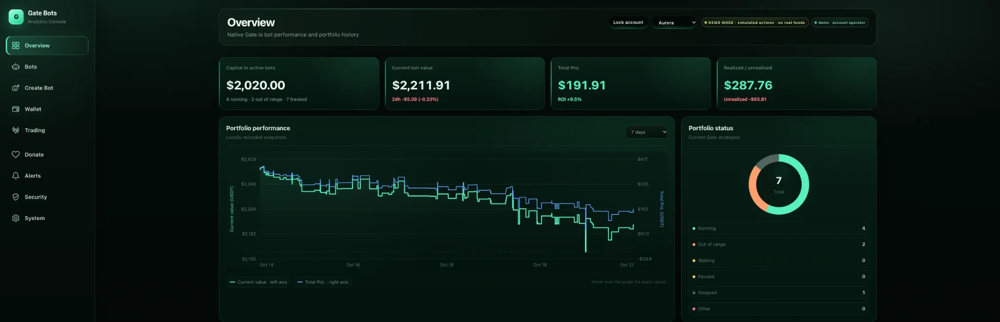
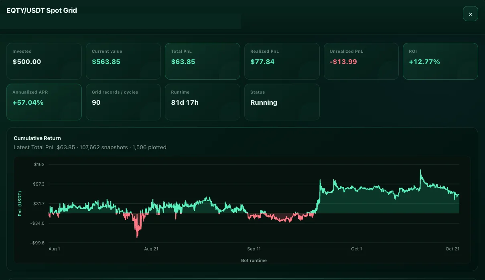
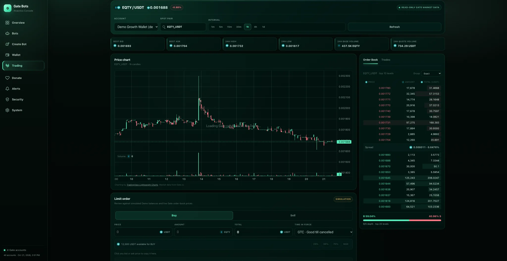
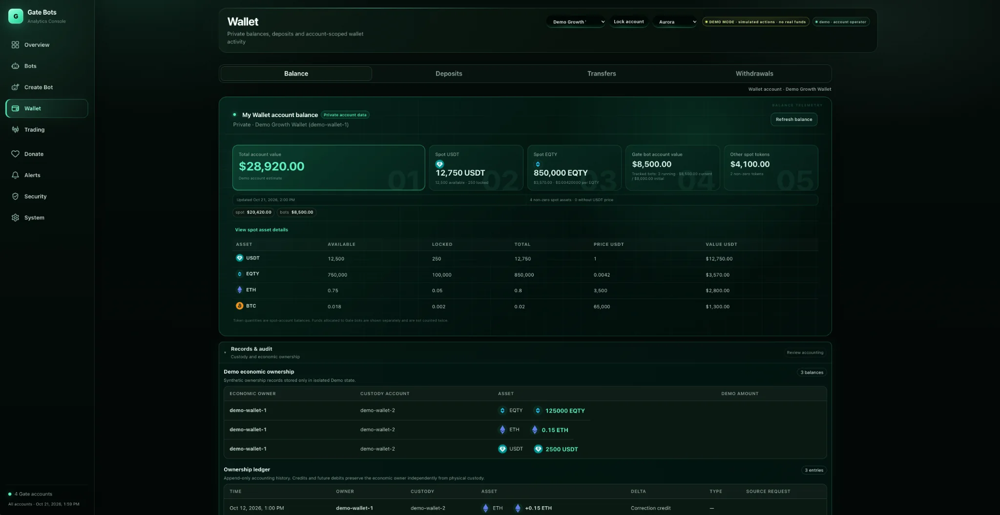
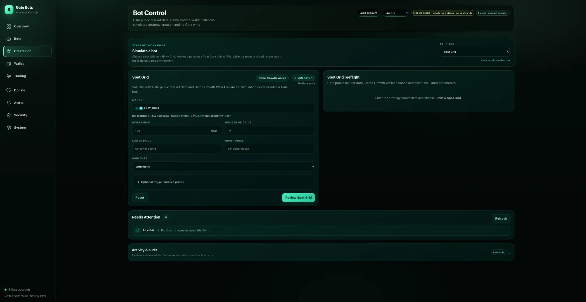
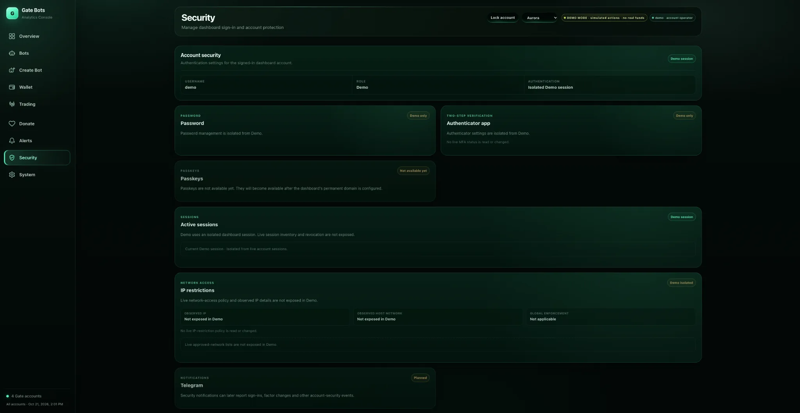

# Gate Control Center (GCC)

**Self-hosted Gate.io trading, native trading bot monitoring, portfolio analytics, and wallet management.**

[**Explore the GCC Live Demo**](https://zolpho.github.io/gate-bot-dashboard/) · [Developer: zolnode](https://github.com/Zolpho)

Gate Control Center (GCC) brings Gate.io operations into a unified web interface. Originally built to monitor exchange-native trading bots, it has evolved to include supported trading operations, multi-account wallet management, analytics, security, and administrative controls.

> **Project status:** Active development · **Source:** Private / proprietary · **Exchange:** Gate.io

## Screenshots

These captures illustrate the Aurora interface. Some screens use isolated simulated demo data, while native bot metrics may reflect live exchange read-only data. Screenshots are illustrative, not investment results or evidence of live demo trading.

### Overview

Portfolio performance and native bot status at a glance.

### Native bot performance

Cumulative performance charts and trading metrics for supported native bots.

### Trading

Market data, candlestick chart and order book with simulated order entry in Demo.

### Wallet

Account-scoped wallet balances and asset reporting using simulated Demo balances.

More screenshots — Bot Control and Security

### Bot Control

Simulated Spot Grid strategy configuration and review.

### Security

Isolated Demo-session security presentation.

[**Open GCC Live Demo →**](https://zolpho.github.io/gate-bot-dashboard/)

## Features

- **Native trading bots:** Monitor and manage supported Gate.io Spot Grid and Infinity Grid bots; review configuration, status and performance.
- **Portfolio and trading:** Monitor balances and market information, review orders and trading activity, and use supported trading operations through the Gate.io API.
- **Wallet:** View assets, balances, and supported deposit, withdrawal and transfer workflows.
- **Security:** Authentication, per-account action controls, root administrator policies, and auditing.
- **Interfaces:** Aurora, Classic, and isolated Demo experiences.

## Development Activity

GCC is actively developed in a private source repository. This public activity feed exposes only **commit dates and reviewed commit titles**—not source code, hashes, authors, diffs, private links, credentials, or operational details.

<!-- gcc-development-activity:start -->

**Private `main` history:** **419** published commits from **August 1, 2026** through **October 24, 2026**.

**By month:** **August:** 237 · **September:** 106 · **October:** 76

### Recent activity

- **2026-10-24** — Add public GCC development activity sync
- **2026-10-24** — Default dashboard to Aurora and compact interface selector
- **2026-10-24** — Place withdrawal confirm action with authorization
- **2026-10-24** — Prioritize withdrawal lifecycle in request detail
- **2026-10-24** — Clarify withdrawal lifecycle progress
- **2026-10-22** — Use single confirmation for withdrawal lifecycle
- **2026-10-22** — Align Wallet transfer confirmation styling
- **2026-10-21** — Improve shared trading cancellation confirmation UX
- **2026-10-21** — Fix Demo trading execution status presentation
- **2026-10-21** — Fix Demo trading execution result validation
- **2026-10-21** — Fix Demo trading preview public-read validation
- **2026-10-19** — Replace MIT license with proprietary EQTY DAO license

[**View the complete development history →**](DEVELOPMENT.md)

<!-- gcc-development-activity:end -->

### GitHub contribution graph

For broader development activity, [view Zolpho's GitHub profile and contribution graph](https://github.com/Zolpho). When GitHub's **Private contributions** option is enabled, private-repository activity appears there anonymously. The profile graph covers overall GitHub activity, not GCC exclusively.

## Issues, Feedback & Roadmap

The public [GCC Issues tracker](https://github.com/Zolpho/gate-control-center/issues) is the place for:

- reproducible product bugs
- user-facing feature requests
- feedback about GCC behavior or usability
- selected public roadmap and exploration items

GCC development and source remain private. Internal implementation work, deployment/infrastructure details, security investigations, and other operationally sensitive work are intentionally kept out of the public tracker.

**Never post API keys, API secrets, account credentials, recovery material, private account details, or sensitive screenshots in a public issue.**

### Selected roadmap

- [Native Open Orders for Spot Grid and Infinity Grid](https://github.com/Zolpho/gate-control-center/issues/1)
- [Telegram notifications and read-only bot integration](https://github.com/Zolpho/gate-control-center/issues/2)
- [Passkey / WebAuthn login](https://github.com/Zolpho/gate-control-center/issues/3)
- [Show the actual Gate VIP level for each Wallet account](https://github.com/Zolpho/gate-control-center/issues/5)
- [Multi-exchange support (KuCoin and Binance)](https://github.com/Zolpho/gate-control-center/issues/6) — **Exploring / nice to have**

Completed public product milestones may also be retained in Issues for context, such as [Demo mode](https://github.com/Zolpho/gate-control-center/issues/4).

## Availability

**The application source code is private and not published here.** This public repository showcases the product and is not an installable open-source release.

## Disclaimer

Gate Control Center is an independent third-party project, not affiliated with or endorsed by Gate.io. Cryptocurrency trading carries financial risk. Functionality depends on available APIs, exchange permissions, and configured safeguards.

---

Developed and maintained by **zolnode**.
